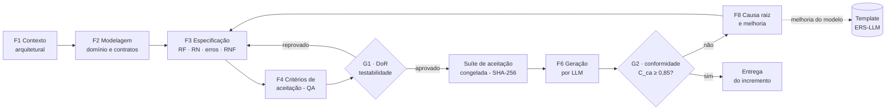

# Processo de Análise de Requisitos Orientado a LLM (ERS-LLM)

**Disciplina:** Sistemas Distribuídos · **Sistema-alvo:** Portal B2B Distribuído (Microsserviços + Kafka)
**Grupo:** Testes / Qualidade (QA) · **Versão do processo:** 1.2 (revisão de QA; o experimento relatado usou a v1.1)

**Integrantes do grupo (Testes / QA):** Amanda Barbosa; Kayky Momoli; Lavínia Maria Moreira; Gabriel Jonas Lucio; Matheus Silva Pains; Igor Santos; Nicole Gomes C Yssob; Igor Nascimento Balduíno; Antonio Calixto.

---

## 1. Propósito

O processo ERS-LLM transforma o conhecimento sobre um microsserviço da arquitetura em um documento de requisitos em Markdown que uma LLM consegue implementar com **conformidade ≥ 85%**, medida por testes de aceitação automatizados.

Ele parte de uma premissa de QA: **uma LLM não pergunta, ela supõe**. Cada lacuna do documento vira uma suposição da LLM, e cada suposição é uma chance de não conformidade. Por isso o processo trata o documento de requisitos como um artefato **testável**. Os critérios de aceitação são escritos junto com os requisitos, viram testes antes de qualquer código existir, e a conformidade é medida, não opinada.

## 2. Princípios

1. **Testabilidade primeiro.** Se não dá para escrever um teste para uma frase, ela não é requisito. Reescreva ou remova.
2. **Literalidade.** Nomes de rotas, campos, tópicos, códigos de erro e enumerações são contratos. A LLM deve copiá-los, não interpretá-los.
3. **Determinismo.** Onde houver mais de uma resposta possível (qual erro retornar primeiro, o que fazer com uma mensagem duplicada), o documento decide.
4. **Infraestrutura como porta.** Broker, relógio e banco entram como interfaces injetadas. Assim o QA consegue testar o comportamento distribuído (eventos, prazos, idempotência) sem Kafka real.
5. **Escopo fechado.** O que não deve ser feito também é escrito. Isso impede a LLM de "completar" o sistema com funcionalidades inventadas.
6. **Teste antes do código.** A suíte de aceitação é derivada dos CAs e congelada (hash SHA-256) antes da geração. Isso elimina o viés de ajustar o teste ao código.
7. **Melhoria baseada em evidência.** Toda não conformidade passa por análise de causa raiz e realimenta o documento ou o modelo.

## 3. Papéis

| Papel | Responsabilidade no processo |
|---|---|
| **PO / Analista de negócio** | Dono das regras de negócio e das prioridades; responde às questões em aberto. |
| **Arquiteto** | Garante coerência com a arquitetura: tópicos, chaves de partição, contratos entre serviços. |
| **Desenvolvedor** | Define as restrições técnicas, as portas e o ponto de entrada; revisa a viabilidade. |
| **QA (nosso grupo)** | Conduz a derivação de CAs, a revisão de testabilidade (gate G1), a suíte de aceitação, a medição de conformidade (gate G2) e a análise de causa raiz. |

### Matriz RACI

| Fase | PO | Arquiteto | Dev | QA |
|---|---|---|---|---|
| F1 Contexto | A | R | C | C |
| F2 Modelagem | C | A | R | C |
| F3 Especificação | A | C | R | R |
| F4 Critérios de aceitação | C | C | C | **A/R** |
| F5 Validação (G1) | C | C | C | **A/R** |
| F6 Geração | I | I | R | A |
| F7 Verificação (G2) | I | I | C | **A/R** |
| F8 Retroalimentação | C | C | R | **A/R** |

R = responsável · A = aprovador · C = consultado · I = informado

## 4. Visão geral do fluxo

## 5. Fases

### F1 — Contexto arquitetural
**Objetivo:** situar o serviço na arquitetura distribuída antes de pensar em funcionalidades.

| Entradas | Atividades | Saídas |
|---|---|---|
| Diagrama de arquitetura; fluxo principal do negócio | 1. Identificar o *bounded context* e seu banco próprio. 2. Listar eventos **consumidos** e **produzidos** (tópicos Kafka) e as chamadas REST. 3. Mapear o passo do fluxo de negócio em que o serviço atua. 4. Registrar escopo dentro/fora. | Seções 2 e 3 do documento; lista inicial de questões (§13) |

*Aplicação ao Portal B2B:* o serviço 6 (Negociação/Leilão) consome `leilao_iniciado` (do Mercado) e produz `lance_realizado` e `negociacao_fechada` (para Pedidos). Ele atua nos passos 5 → 6 → 7 do fluxo principal.

### F2 — Modelagem de domínio e contratos
**Objetivo:** fixar a forma dos dados e das interfaces.

| Entradas | Atividades | Saídas |
|---|---|---|
| Saídas de F1 | 1. Entidades com tipo, obrigatoriedade e restrição de cada atributo. 2. Máquina de estados (tabela de transições). 3. Contratos REST com exemplo JSON completo. 4. Envelope e payload de cada evento, com **chave de partição**. 5. Portas de infraestrutura (EventBus, Clock…) e assinatura exata do ponto de entrada. | Seções 5, 6 e 7 |

**Preocupações de sistemas distribuídos que devem ser decididas aqui:**
- **Entrega *at-least-once*:** o que acontece com uma mensagem duplicada (idempotência do consumidor)?
- **Mensagem inválida:** descartar, registrar ou enviar para DLQ?
- **Ordenação:** qual chave de partição garante a ordem dos eventos de uma mesma entidade?
- **Reenvio pelo cliente:** existe `Idempotency-Key` nas operações de escrita?
- **Tempo:** o relógio é uma porta injetada (nunca o relógio do sistema)?
- **Isolamento:** o estado pertence à instância (sem estado global)?

### F3 — Especificação
**Objetivo:** escrever requisitos atômicos, sem ambiguidade e rastreáveis.

| Entradas | Atividades | Saídas |
|---|---|---|
| Saídas de F2 | 1. RFs no padrão **EARS**, com prioridade MoSCoW. 2. Regras de negócio declarativas, cada uma com exemplo concreto. 3. **Catálogo de erros** com código, HTTP e condição, mais a **ordem de verificação**. 4. RNFs pela ISO/IEC 25010 com métrica, limiar e forma de verificação. 5. Diretivas para a LLM (§1 do modelo). | Seções 1, 8 (enunciados), 9, 10 e 11 |

### F4 — Derivação de critérios de aceitação (liderada pelo QA)
**Objetivo:** transformar cada requisito em cenários verificáveis.

Técnicas de projeto de teste aplicadas ao derivar CAs:

| Técnica | Uso no documento | Exemplo (ESP-NEG-001) |
|---|---|---|
| Partição de equivalência | Uma classe válida e as inválidas de cada entrada | `valor`: string válida / número / texto / negativo / zero / 3 casas |
| Análise de valor-limite | Valores exatamente na borda | `1000.00` aceito e `1000.01` recusado; relógio **igual** a `encerra_em` |
| Tabela de decisão | Combinação perfil × tipo de leilão | COMPRADOR×REVERSO → 403 |
| Transição de estados | Cada transição válida e uma inválida | Encerrar duas vezes → 409 |
| Combinação de erros | Mais de um erro ao mesmo tempo | Corpo inválido em leilão inexistente → 404 |
| Cenários distribuídos | Duplicidade, DLQ, chave de partição, reenvio | Evento repetido ignorado; `Idempotency-Key` |

Regras: cada RF tem pelo menos 1 CA de sucesso e 1 de erro; todo CA usa **valores concretos** e um resultado **observável** (status, corpo, evento publicado, estado consultável).

**Saídas:** seção 8 (CAs em Gherkin) e matriz de rastreabilidade (§12).

### F5 — Validação do documento (Gate G1 — Definition of Ready)
**Objetivo:** impedir que um documento ambíguo chegue à LLM.

Atividades:
1. **Inspeção com checklist** (§14 do modelo). Todos os itens devem estar marcados.
2. **Varredura de termos vagos.** Busca textual por: *adequado, rápido, eficiente, etc., e/ou, normalmente, se possível, tratar erros, entre outros, quando necessário*. Cada ocorrência é quantificada ou removida.
3. **Consistência cruzada:** códigos de erro dos CAs ⊆ catálogo; campos dos exemplos JSON = tabela da entidade; todo tópico tem chave e exemplo.
4. **Rastreabilidade:** nenhum RF sem CA e nenhum CA órfão.
5. **(Opcional) Leitura adversarial por LLM:** pedir a uma LLM, *sem gerar código*, que liste as ambiguidades que encontrar no documento. Cada item listado é resolvido ou registrado em §13.

**Critério de saída:** checklist 100% e nenhuma questão aberta em §13. Status passa para *Aprovado para geração*.

### Construção da suíte de aceitação (entre G1 e F6)
O QA implementa um teste automatizado por CA (nome `test_CA<NN>_...`), usando dublês das portas (EventBus e Clock falsos). Antes do experimento, a suíte é validada de duas formas:
- **Oráculo:** uma implementação de referência deve passar em 100% dos testes. Isso prova que os testes não estão errados.
- **Análise de mutantes:** versões propositalmente defeituosas da referência devem ser detectadas. Isso prova que os testes não estão frouxos.

Depois disso, a suíte é **congelada** e o hash SHA-256 dos arquivos é registrado.

### F6 — Geração por LLM
- Prompt **fixo e versionado** (`experimento/prompt_geracao.md`): o documento é a única fonte.
- Contexto novo a cada execução, sem acesso aos testes e sem correção manual do código gerado.
- Geração em passada única. A LLM não executa nem testa o próprio código: mede-se a qualidade do documento, não a capacidade de depuração da LLM.

### F7 — Verificação de conformidade (Gate G2)
Métricas:

| Métrica | Fórmula | Uso |
|---|---|---|
| **C_ca** (primária) | CAs atendidos / CAs totais | Gate: **C_ca ≥ 0,85** |
| **C_rf** (estrita) | Requisitos com todos os CAs atendidos / requisitos totais | Indica requisitos inteiros que falharam |
| Cobertura de rastreabilidade | RFs com ≥ 1 CA / RFs totais | Deve ser 100% em G1 |
| Densidade de ambiguidade | Termos vagos / 1000 palavras | Deve ser 0 em G1 |

Um CA só é atendido se **todos** os casos de teste com o seu prefixo passarem. CA não executado (por exemplo, código que nem importa) conta como não atendido.

### F8 — Análise de causa raiz e melhoria
Cada CA não atendido é classificado:

| Categoria | Pergunta | Ação |
|---|---|---|
| **Omissão** | O documento deixou de dizer algo necessário? | Acrescentar ao documento; avaliar se o modelo deve ganhar seção/campo. |
| **Ambiguidade** | O texto admite mais de uma leitura? | Reescrever com exemplo concreto ou regra literal. |
| **Contradição** | Duas partes do documento dizem coisas diferentes? | Corrigir; reforçar a regra de precedência. |
| **Desvio da LLM** | O documento era claro e a LLM não seguiu? | Reforçar a instrução no ponto de uso (repetir a regra perto do contrato); registrar como limitação. |
| **Defeito do teste** | O teste não corresponde ao CA? | Corrigir o teste e reavaliar **todas** as execuções; registrar o desvio no relatório. |

**Análise de decisões, mesmo com 100% de conformidade.** A diretiva 4 do modelo obriga a LLM a marcar com `# DECISÃO:` tudo o que ela precisou supor. O QA faz `grep -rn "DECISÃO" <código>` em cada geração. Cada decisão é uma ambiguidade que os testes ainda não pegaram: vira regra explícita no documento e, se for recorrente, linha nova na tabela de casos de borda do modelo. Foi esse o mecanismo que levou o documento e o modelo da v1.0 para a v1.1 no piloto (Relatório §4).

Melhorias recorrentes viram mudança no **modelo** (nova versão do template). Melhorias específicas viram nova versão do **documento**. Volta-se então para F3 (design iterativo).

## 6. Artefatos produzidos

| Artefato | Arquivo |
|---|---|
| Modelo do documento de requisitos | `02_Template_Documento_Requisitos.md` |
| Instruções de preenchimento | `03_Instrucoes_Preenchimento.md` |
| Documento preenchido (exemplo real) | `experimento/especificacao/ESP-NEG-001_Negociacao_Leilao.md` |
| Suíte de aceitação + harness | `experimento/testes/` |
| Avaliador de conformidade | `experimento/avaliar.py` |
| Relatório técnico do experimento | `04_Relatorio_Tecnico_Experimento.md` |

## 7. Escalabilidade para a arquitetura completa

O processo é aplicado **um bounded context por vez**: um documento ERS-LLM por microsserviço (Usuários, Produtos, Fornecimentos, Demanda, Mercado, Negociação, Pedidos, Logística, Transportadoras). Os contratos de evento são o ponto de integração entre documentos. Por isso, ao especificar um tópico (§7.4), o documento do serviço **produtor** é a fonte da verdade, e o documento do **consumidor** referencia o mesmo exemplo de mensagem. O arquiteto revisa essa consistência em F2.

## 8. Complementos da revisão de QA (v1.2 proposta)

**Levantamento e interessados.** Em F1, o analista identifica quem fornece cada regra e contrato (negócio, serviço produtor, serviço consumidor, operação e QA). Registra fonte, data e responsável por responder cada questão. A escolha da técnica de levantamento — entrevista, oficina ou análise de documentação — depende da fonte disponível. Uma premissa sem validação fica marcada como questão, não como decisão aprovada.

**Mudanças.** Cada alteração na ESP recebe versão, motivo, responsável pela decisão e análise de impacto em contratos, CAs, testes, prompt e integrações. A versão usada em uma geração não é sobrescrita. Se um CA ou teste mudar, congela-se uma nova suíte e executa-se uma nova rodada; resultados de versões diferentes são apresentados separadamente.

**Rastreabilidade da execução.** Além da matriz requisito → CA, o QA registra CA → teste e caso parametrizado → resultado → evidência → hash do código avaliado. Resultados parciais, não executados e não avaliáveis aparecem explicitamente. Para declarar um requisito integralmente aprovado, todos os seus critérios obrigatórios devem passar. A métrica `C_ca` continua útil como diagnóstico da suíte; `C_rf` indica aprovação integral dos requisitos pelos CAs cobertos e seus limites de cobertura devem acompanhar o resultado.

**Gate G1.** Exceções à regra de cenário feliz e de erro por RF exigem justificativa na matriz. Questões abertas com impacto em comportamento bloqueiam a aprovação para geração. Itens de checklist não podem ser marcados como concluídos apenas porque a informação é mencionada: exemplos, regras e contratos devem ser conferidos entre si.

**Gate G2.** O avaliador conserva código identificado, versão do documento, modelo e parâmetros da LLM, ambiente, XML/logs de teste e totais por CA e requisito. Falha do instrumento é registrada separadamente da reprovação funcional. A ausência de código ou evidência impede declarar conformidade comprovada.
